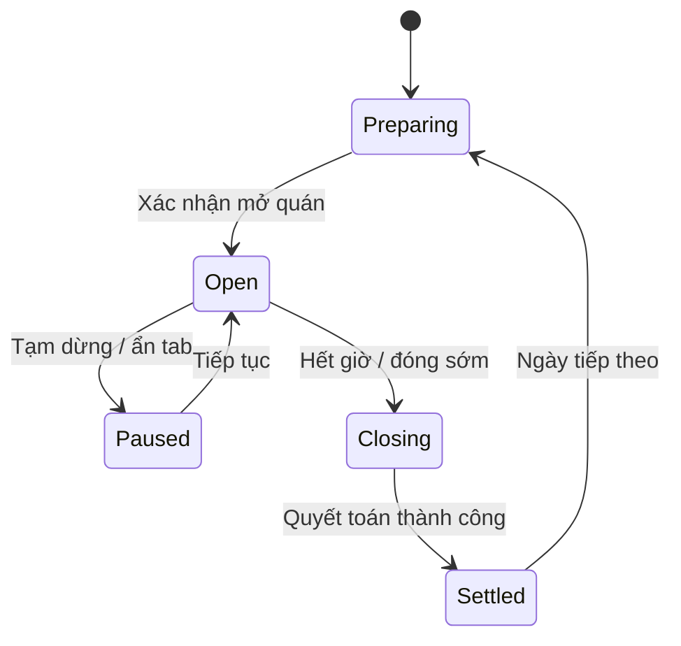
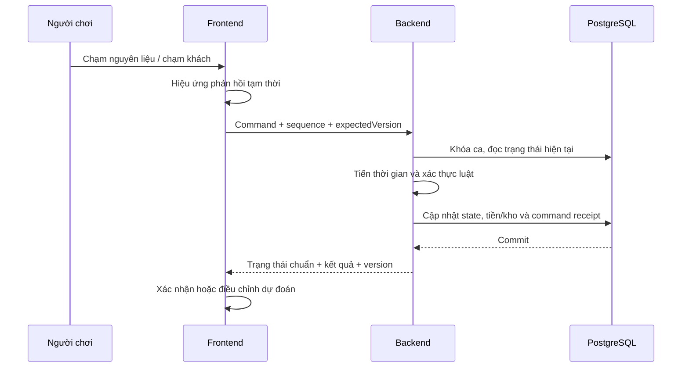

# KẾ HOẠCH WEB GAME QUÁN CHÁO ĐẦU HẺM

Ngày lập: 12/10/2026. Trạng thái: thiết kế đề xuất, chưa triển khai.

## 1. Mục tiêu và phạm vi tài liệu

Xây dựng game kinh doanh quán cháo Việt Nam chơi trên trình duyệt: người chơi nhập hàng, nấu cháo, ghép món, phục vụ khách, quản lý tiền và phát triển cửa hàng. Ưu tiên điện thoại màn hình dọc, hỗ trợ chuột và bàn phím trên máy tính.

Tài liệu bao gồm trải nghiệm, luật chơi, luồng nghiệp vụ, giao diện, backend, dữ liệu, API, kiểm thử và lộ trình. Các thông số kinh tế và thời gian là giả thuyết để playtest, không phải giá kinh doanh thực tế.

Repository hiện tại trước đây là ứng dụng Medsi. Tài liệu này không có nghĩa là đã chuyển đổi ứng dụng sang game. Khi triển khai cần kiểm tra lại working tree, giữ thay đổi của người dùng, không tự khôi phục file đã xóa hoặc ghi đè source hiện có. Việc chọn thư mục triển khai và thay thế ứng dụng cũ phải được xác định trước khi viết code.

### 1.1. Tham chiếu

- Game mẫu: https://saigoneseecoffee.github.io/saigonesee-game/
- Repository tham chiếu: https://github.com/saigoneseecoffee/saigonesee-game
- Đã đọc nội dung và mã nguồn công khai, chưa trực tiếp playtest trong trình duyệt. Phiên bản nguồn được truy cập có thể khác bản đang phát hành.
- Các đặc điểm đã xác định: khung dọc, đơn trên đầu khách, thanh kiên nhẫn, chạm nguyên liệu rồi chạm khách để giao, nhập hàng và nâng cấp.
- Game quán cháo dùng mã nguồn, tên, hình ảnh và âm thanh riêng; tham khảo cách tổ chức trải nghiệm.

### 1.2. Mục tiêu nghiệm thu sản phẩm

- Người mới hoàn thành đơn đầu trong khoảng một phút với hướng dẫn.
- Chơi trọn vòng nhập hàng → mở quán → phục vụ → tổng kết → nâng cấp.
- Bảy ngày đầu giới thiệu cơ chế theo từng bước; sau đó tiếp tục chơi với độ khó có giới hạn.
- Không mất tiến trình đã xác nhận; không cộng tiền hoặc trừ kho hai lần khi gửi lại thao tác.
- Có bản chơi local trước; bản trực tuyến có tài khoản, backend xác thực kết quả và lưu tiến trình.

## 2. Định hướng gameplay

Tên tạm: **Quán Cháo Đầu Hẻm**. Người chơi bắt đầu từ quầy nhỏ, dần mở thực đơn, mua bếp tốt, thuê người phụ và phát triển quán.

Một ca bán dự kiến 4–6 phút. Nhịp chơi gồm hai lớp:

| Trong ca | Giữa các ca |
| --- | --- |
| Đọc đơn và ưu tiên khách | Dự báo nhu cầu, nhập nguyên liệu |
| Chạm thành phần để làm tô | Chọn thực đơn |
| Chạm khách để giao món | Xem báo cáo tiền và nguyên liệu |
| Quản lý nồi cháo theo mẻ | Mua nâng cấp, mở món |
| Phối hợp người phụ ở bản mở rộng | Thuê người, định giá ở bản mở rộng |

### 2.1. Thực đơn ban đầu

| Món | Công thức cơ bản | Mở khóa đề xuất |
| --- | --- | --- |
| Cháo thịt bằm | Cháo nền + thịt bằm + hành | Ngày 1 |
| Cháo gà | Cháo nền + gà + hành | Ngày 2–3 |
| Cháo sườn | Cháo nền + sườn + hành | Ngày 5–7 |
| Cháo nấm | Cháo nền + nấm + hành | Bản nội dung tiếp theo |

Topping: trứng, tiêu, quẩy. Yêu cầu riêng ban đầu: không hành, thêm trứng. Công thức được lưu theo số lượng thành phần, không theo thứ tự thao tác. Chỉ sinh đơn từ món đang bán và đã mở khóa; việc thiếu hàng trong ca vẫn có thể xảy ra do người chơi nhập thiếu.

### 2.2. Luật ghép và giao tô

1. Bấm cháo nền để đưa một phần vào tô hiện tại.
2. Bấm thịt và topping; hình tô và danh sách thành phần cập nhật ngay.
3. Thành phần chuyển từ kho/nồi sang tô và không thể đồng thời dùng cho tô khác.
4. Chạm khách: hệ thống đối chiếu tô với một món chưa hoàn thành của khách đó.
5. Đúng công thức: hoàn thành món, ghi tiền, tiền boa và điều chỉnh đánh giá.
6. Sai công thức: mất tô, ghi hao hụt, giảm kiên nhẫn và đánh giá; không thu tiền.
7. Nút bỏ tô xác nhận trực tiếp hành động bỏ, ghi hao hụt một lần.

MVP không hoàn nguyên nguyên liệu đã cho vào tô. Có thể bổ sung thao tác hoàn tác trước khi giao sau playtest nhưng phải cập nhật quy tắc kho tương ứng. Không tự thêm hành nếu người chơi chưa bấm.

Đơn có yêu cầu riêng được so sánh chính xác với công thức đã điều chỉnh. MVP không trả thưởng một phần cho món thiếu yêu cầu, giúp luật chơi dễ hiểu. Một khách một tô ở bản đầu; nhiều tô triển khai sau, thu tiền từng tô và khách rời quán khi cả đơn hoàn tất.

### 2.3. Nấu theo mẻ

- Một loại cháo nền trong MVP; topping được coi là đã sơ chế để tránh quá nhiều công đoạn.
- Nồi có trạng thái rỗng, đang nấu, sẵn sàng; lưu số phần còn lại.
- Bắt đầu nấu trừ gạo và chi phí nguyên liệu của mẻ, tạo thời điểm hoàn thành.
- Nồi chỉ cấp phần sau khi nấu xong. Nấu không tiêu thụ lại nguyên liệu khi tải lại trang.
- Bản đầu một nồi: không nấu mẻ mới khi nồi chưa hết. Nâng cấp tiếp theo có thể mở nồi dự phòng.
- Cháo nền còn dư cuối ca thành hao hụt; nguyên liệu chưa dùng còn hạn chuyển sang ngày sau.
- Ca đầu có mẻ hướng dẫn được chuẩn bị trước, hiển thị rõ là quà khởi đầu.

### 2.4. Khách hàng

- Ba vị trí phục vụ lúc đầu; số khách chờ chỉ tăng khi mua nâng cấp tương ứng.
- Mỗi khách có đơn, thời điểm đến, thời hạn chờ và trạng thái.
- Khi hết kiên nhẫn: khách bỏ về, ghi mất khách và giảm đánh giá.
- Nếu giao đúng thời điểm hết hạn, quy tắc thống nhất là phải có thời gian xử lý nhỏ hơn hạn chờ mới hợp lệ.
- Khách mới: đơn đơn giản, chờ lâu. Khách văn phòng: đến theo đợt. Khách quen và khách khó tính triển khai sau.
- Tăng độ khó bằng lượng khách, số món và yêu cầu riêng; mỗi ngày chỉ nên đưa thêm một yếu tố chính.

## 3. Kinh tế và tiến trình

### 3.1. Quy tắc tiền và tồn kho

- Tiền lưu bằng số nguyên VND; số lượng nguyên liệu dùng đơn vị phần/gói nguyên, không dùng số thực thiếu kiểm soát.
- Mua hàng làm giảm tiền mặt và tăng giá trị tồn kho, chưa tính toàn bộ là chi phí món bán.
- Khi tiêu thụ nguyên liệu, chuyển giá trị từ kho sang tô hoặc mẻ cháo.
- Khi bán, ghi giá vốn tô; khi bỏ, ghi chi phí hao hụt. Không hạch toán hai lần.
- MVP dùng giá nguyên liệu cố định cho mỗi phiên bản cân bằng. Khi giá biến động ở bản sau, dùng bình quân gia quyền hoặc FIFO và chốt một phương pháp.
- Doanh thu = tiền bán món + tiền boa. Lợi nhuận vận hành = doanh thu − giá vốn món đã bán − hao hụt − phí ca − lương.
- Mua thiết bị là dòng tiền đầu tư, hiển thị riêng, không trừ tiếp vào lợi nhuận vận hành.
- Báo cáo phải đối chiếu được tiền đầu ca + thu − chi = tiền cuối ca.

### 3.2. Thông số để thử nghiệm

| Thông số | Giá trị khởi điểm |
| --- | --- |
| Tiền ban đầu | 300.000đ |
| Giá tô | 20.000–35.000đ |
| Giá vốn mục tiêu | Khoảng 35–50% giá món |
| Khách ngày đầu | 8–12 |
| Dung tích nồi | 6–8 phần |
| Thời gian nấu | 12–18 giây game |
| Thời gian chờ khách | 35–55 giây game |
| Đánh giá | Thang 1–5 |
| Nâng cấp đầu | Khoảng 150.000đ |

Tiền boa dựa trên phần thời gian chờ còn lại, có trần, chỉ cấp khi đúng món. Công thức, giá, thời gian, mức phạt và điều kiện mở khóa đều ở bảng cấu hình có phiên bản. Khóa phiên bản cấu hình cho suốt một ca.

### 3.3. Nâng cấp

| Hạng mục | Hiệu quả | Giới hạn cần kiểm soát |
| --- | --- | --- |
| Nồi lớn | Tăng phần/mẻ | Không tự cấp cháo miễn phí khi nâng cấp |
| Bếp tốt | Rút ngắn thời gian nấu | Có thời gian tối thiểu |
| Kệ kho | Tăng sức chứa | Không nhập vượt sức chứa |
| Khu chờ | Thêm khách chờ | Không tăng quá mức đọc được trên điện thoại |
| Trang trí | Tăng nhẹ kiên nhẫn | Có trần cộng dồn |
| Bảng hiệu | Tăng nhu cầu | Có cảnh báo nếu năng lực phục vụ thấp |

Mua nâng cấp giữa các ca bán; hiển thị giá, cấp hiện tại và tác dụng trước/sau. Không cho mua vượt cấp tối đa hoặc thiếu tiền.

### 3.4. Hết vốn và tiến độ

- Trước mở ca, nếu không đủ nguyên liệu cho ít nhất một món thì hướng dẫn nhập hàng.
- Khi không đủ tiền mua gói tối thiểu, cho nhận gói hỗ trợ một lần cho mỗi save; backend ghi cờ đã nhận.
- Hết hàng giữa ca có thể đóng sớm và nhận báo cáo thực tế; không tự sinh doanh thu bù.
- Bảy ngày đầu là phần hướng dẫn tiến triển, không phải giới hạn tổng số ngày.
- Mục tiêu cân bằng: mua được nâng cấp đầu sau khoảng 2–3 ca hợp lý; không bắt người mới tối ưu từng thao tác mới có lãi.

## 4. Luồng nghiệp vụ và trạng thái

### 4.1. Vòng đời ca bán



Quy tắc MVP: hết ca ngừng sinh khách, khách và đơn chưa xong đóng lại, tô dở và cháo dư thành hao hụt. Ghi riêng đơn chưa phục vụ, không tính là khách tự bỏ vì chờ quá lâu. Tạm dừng không tiêu thụ thời gian game; không có thu nhập offline.

### 4.2. Bắt đầu chơi / đăng nhập / tiếp tục

1. Tải cấu hình nội dung và kiểm tra phiên bản save.
2. Chế độ thử local: tạo hoặc đọc save trên thiết bị, hiển thị phạm vi lưu.
3. Chế độ trực tuyến: kiểm tra session đăng nhập, backend trả cửa hàng và ca đang hoạt động.
4. Nếu ca đang mở, khôi phục snapshot và đồng bộ thời gian trước khi nhận thao tác.
5. Nếu chưa có cửa hàng, backend tạo cửa hàng và gói khởi đầu một lần trong transaction.
6. Hiển thị ngày hiện tại và bước hướng dẫn chưa hoàn thành.

Save local không được tự chuyển thành thành tích xếp hạng đã xác thực. Bản online đầu tiên tạo tiến trình mới; chức năng nhập save local chỉ có thể dùng cho chế độ tự do không xếp hạng ở bản sau.

### 4.3. Nhập nguyên liệu

1. Người chơi chọn nguyên liệu và số gói.
2. Frontend hiển thị chi phí dự kiến, số lượng sau mua, sức chứa.
3. Backend xác thực quyền sở hữu, trạng thái chuẩn bị, phiên bản cửa hàng và khóa chống gửi trùng.
4. Backend tự lấy giá từ catalog; kiểm tra số lượng nguyên dương, đủ tiền và chỗ chứa.
5. Trong một transaction: trừ tiền, cộng kho, ghi sổ và tăng phiên bản.
6. Trả trạng thái mới; UI không cộng kho lần nữa nếu phản hồi bị gửi lại.

### 4.4. Mở ca

1. Chọn các món sẽ bán; kiểm tra món đã mở khóa.
2. Kiểm tra nguyên liệu tối thiểu, không có ca khác chưa quyết toán.
3. Tạo ca với seed ngẫu nhiên, cấu hình cân bằng, thực đơn và snapshot ban đầu.
4. Bắt đầu đồng hồ game; sinh lịch khách theo seed ở backend/bộ máy local.
5. UI hiển thị ca và khách đầu tiên, bắt đầu hướng dẫn khi cần.

### 4.5. Xử lý một thao tác phục vụ trực tuyến



Client gửi ý định, không gửi số tiền thưởng hay kho mới để server tin trực tiếp. Lệnh đến muộn xử lý tại thời gian game phía server, không tin timestamp client. Mạng chậm có thể ảnh hưởng ca; cần thông báo rõ và ưu tiên phản hồi nhanh ở UI.

### 4.6. Tổng kết và ngày tiếp theo

1. Chuyển ca sang `closing`, chặn lệnh phục vụ mới.
2. Chốt khách, doanh thu, giá vốn, hao hụt và phí một lần.
3. Ghi báo cáo, cập nhật tiền, đánh giá, mở khóa và snapshot.
4. Đánh dấu `settled` cùng transaction với kết quả kinh tế.
5. Frontend hiển thị báo cáo có số liệu lấy từ server.
6. Nút ngày tiếp theo tạo trạng thái chuẩn bị của ngày mới một lần; bấm lặp trả cùng kết quả.

### 4.7. Mất mạng, tải lại và nhiều tab

- Local: tự lưu sau lệnh quan trọng, khi tạm dừng và cuối ca; có backup và phiên bản schema.
- Online: backend là nguồn dữ liệu chính; IndexedDB chỉ giữ bản cache đã xác nhận, không là bằng chứng tiền/thành tích.
- Khi mất kết nối, UI khóa thao tác ảnh hưởng tiền và hiện trạng thái đang đồng bộ. Không tiếp tục nhận hàng loạt lệnh offline.
- Ca online dùng lease heartbeat: heartbeat mỗi 5 giây; quá 15 giây không nhận heartbeat thì server tự tạm dừng tại mốc hết lease. Trong khoảng phát hiện mất mạng, ca vẫn có thể tiến tối đa 15 giây; UI phải giải thích khi khôi phục.
- Trước mỗi command, server kiểm tra lease. Nếu ca quá hạn, xử lý các sự kiện chỉ tới mốc hết lease rồi dừng; không chạy bù toàn bộ thời gian offline.
- `visibilitychange` cố gửi pause; nếu không gửi được, lease là cơ chế dự phòng. Tab hiện lại lấy snapshot rồi mới resume.
- Một tab/thiết bị giữ quyền điều khiển ca. Tab khác chỉ xem; nhận quyền điều khiển mới làm mất hiệu lực token của tab cũ.
- Lệnh bị timeout được hỏi lại hoặc retry với cùng `commandId`, không sinh ID mới. Lệnh trùng trả kết quả đã lưu, không thực thi lại.

## 5. Danh sách chức năng và mức ưu tiên

| Nhóm | P0: bản local chơi được | P1: bản online hoàn chỉnh | P2: mở rộng |
| --- | --- | --- | --- |
| Phục vụ | Ghép tô, khách chờ, giao sai/đúng | Server xác thực, khôi phục ca | Nhiều tô/đơn |
| Nấu | Một nồi, nấu theo mẻ | Đồng bộ trạng thái nồi | Nồi dự phòng, nhiều nền cháo |
| Kinh doanh | Kho, nhập hàng, báo cáo, nâng cấp | Transaction và sổ giao dịch | Định giá, khuyến mại |
| Tiến trình | Ba món, bảy ngày hướng dẫn | Lưu tài khoản, thành tích | Chi nhánh, giao hàng |
| Người phụ | Chưa có | Một người phụ, lương và tiến độ tự động | Phân ca, kỹ năng, quản lý |
| Dữ liệu | Save thiết bị, xuất/nhập | PostgreSQL, backup | Bảng xếp hạng xác thực |
| Trải nghiệm | Cảm ứng, âm thanh, tạm dừng | Đăng nhập, xử lý mạng | Khách quen, sự kiện |

P1 người phụ chỉ nhận một đơn chưa có ai phụ trách, trừ nguyên liệu và khóa đơn khi bắt đầu. Người chơi không giao trùng đơn đó. Hoàn tất/đóng ca giải phóng trạng thái phân công nhất quán. Lương được chốt cuối ca theo cấu hình đã khóa đầu ca.

Không đưa thanh toán tiền thật, nhiều người cùng chơi, nền kinh tế liên server hoặc thu nhập offline vào phạm vi ban đầu.

## 6. Thiết kế frontend

### 6.1. Công nghệ đề xuất

- React + TypeScript + Vite cho UI; kiểm tra phiên bản tương thích khi thực hiện cài đặt.
- CSS/Tailwind cho bố cục và hiệu ứng nhẹ; SVG/hình minh họa riêng cho món và nhân vật.
- Zustand cho trạng thái giao diện, TanStack Query cho lấy dữ liệu ngoài ca; command trong ca đi qua hàng đợi riêng có thứ tự.
- Bộ máy luật viết TypeScript thuần, độc lập React để tái sử dụng cho prototype và backend.
- DOM/SVG đủ cho MVP; chưa cần Canvas hoặc engine game lớn.
- Vitest cho logic, Playwright cho kiểm thử E2E khi có môi trường chạy trình duyệt.

Đây là lựa chọn kiến trúc dự kiến, không yêu cầu giữ nguyên thư viện của ứng dụng Medsi. Cần thông báo trước mọi sửa đổi cấu hình khi bắt đầu triển khai.

### 6.2. Màn hình

| Màn hình | Nội dung và hành động |
| --- | --- |
| Bắt đầu | Chơi thử, đăng nhập, tiếp tục, hướng dẫn, cài đặt |
| Chuẩn bị | Tiền, dự báo khách, thực đơn, tồn kho, mở quán |
| Nhập hàng | Gói nguyên liệu, giá, sức chứa, xác nhận mua |
| Bán hàng | HUD, khách, hàng chờ, nồi, tô hiện tại, nguyên liệu |
| Sổ công thức | Thành phần, số lượng, món khóa/mở, ví dụ yêu cầu riêng |
| Tổng kết | Thu, chi, lãi, hao hụt, mất khách, gợi ý cải thiện |
| Nâng cấp | Cấp hiện tại, hiệu quả kế tiếp, giá, điều kiện |
| Nhân sự P1 | Thuê người phụ, lương, nhiệm vụ, trạng thái |
| Cài đặt | Âm thanh, giảm chuyển động, lưu local, tài khoản |

### 6.3. Bố cục màn hình bán hàng

```text
┌────────────────────────────────────┐
│ Ngày 3   Tiền   ★ Đánh giá   Tạm dừng│
├────────────────────────────────────┤
│       QUÁN CHÁO ĐẦU HẺM             │
│          Mái hiên                   │
├────────────────────────────────────┤
│ Đơn + yêu cầu    Đơn + yêu cầu       │
│ Khách / thời gian chờ / biểu cảm    │
├────────────────────────────────────┤
│ Hàng chờ / người phụ khi mở khóa    │
├────────────────────────────────────┤
│ Nồi: 5 phần     Tô đang làm    Bỏ tô │
├────────────────────────────────────┤
│ Cháo + thịt | Topping | Ăn kèm      │
│ Các nút nguyên liệu + số tồn        │
├────────────────────────────────────┤
│ Công thức       Trạng thái kết nối  │
└────────────────────────────────────┘
```

- Khung chơi tối đa khoảng 520px, căn giữa desktop; nền hai bên không chứa thao tác thiết yếu.
- Mục tiêu từ 360px chiều rộng, hỗ trợ safe area và bàn phím ảo ở màn hình tài khoản.
- Nút chạm tối thiểu 44×44px; không phụ thuộc hover hoặc chỉ màu sắc.
- Đơn gần hết hạn có icon và nhãn bên cạnh màu cảnh báo.
- Mở bảng công thức/cài đặt trong ca phải tạm dừng nhất quán cả client và server.
- Phím tùy chọn: số chọn nguyên liệu, Escape tạm dừng; luôn có thao tác cảm ứng tương đương.
- Âm thanh bắt đầu sau tương tác đầu tiên; chỉnh nhạc và hiệu ứng độc lập.

### 6.4. Cấu trúc frontend đề xuất

```text
apps/web/src/
  app/                # router, providers, khởi động
  screens/            # màn hình theo nghiệp vụ
  features/
    service/          # khách, đơn, tô
    cooking/          # nồi, mẻ
    inventory/        # nhập hàng, tồn
    progression/      # nâng cấp, mở món
    auth/             # tài khoản online
  components/         # thành phần dùng chung
  stores/             # UI state và trạng thái dự đoán
  services/           # HTTP, command queue, local adapter
  assets/             # ảnh, âm thanh, font
  styles/
```

Không để component trực tiếp tăng tiền hoặc viết database. UI phát command; adapter local/online trả kết quả theo cùng hợp đồng.

## 7. Thiết kế backend

### 7.1. Kiến trúc đề xuất

Backend Node.js + TypeScript + Fastify, PostgreSQL và Prisma. Một ứng dụng backend theo module đủ cho P1; không cần microservices, Redis hoặc WebSocket ngay từ đầu.

```text
React UI → Local adapter → Game core → IndexedDB      (P0)
React UI → HTTPS API → Game service → PostgreSQL      (P1)
                           ↓
                     Shared game core
```

Online dùng HTTP command tuần tự; server không tick ghi DB mỗi khung hình. Server tiến mô phỏng từ snapshot tới thời điểm hiện tại khi xử lý command, heartbeat hoặc đọc ca. Thứ tự sự kiện đồng thời phải xác định được bằng thời điểm rồi ID/loại sự kiện. Client vẽ chuyển động 30–60fps từ trạng thái đã nhận.

### 7.2. Module backend

| Module | Trách nhiệm |
| --- | --- |
| Auth | Đăng ký, đăng nhập, đăng xuất, session |
| Player/Shop | Hồ sơ game, cửa hàng, tiền, đánh giá, phiên bản |
| Catalog | Công thức, nguyên liệu, giá, phiên bản cân bằng |
| Inventory | Mua hàng, sức chứa, số lượng, giá vốn |
| Shift | Mở/đóng/tạm dừng ca, đồng hồ và lease |
| Commands | Chống lặp, sequence, kiểm tra và thực thi lệnh |
| Economy | Sổ tiền, giá vốn, hao hụt, báo cáo |
| Progression | Điều kiện mở món, mua nâng cấp |
| Staff | P1 người phụ, nhận đơn và tính lương |
| Ranking | P2 tổng hợp thành tích đã xác thực |

### 7.3. Nguồn sự thật và transaction

- Server tự tính giá, phần thưởng, thời gian nấu, thời hạn khách và mở khóa.
- Mỗi thao tác thay đổi state trong transaction khóa ca/cửa hàng theo thứ tự cố định để tránh deadlock.
- Kiểm tra command đã tồn tại trước kiểm tra `expectedVersion`, để retry lệnh thành công cũ trả đúng receipt.
- Mỗi ca có `version`, `lastSequence` và `controllerToken`; mỗi command có ID duy nhất.
- Nếu phiên bản lệch, trả `STATE_CONFLICT` cùng version mới; client tải lại state trước tiếp tục.
- Receipt, state mới và các dòng ledger phải commit cùng nhau.
- Quyết toán có ràng buộc unique theo ca, nên retry không trừ lương hoặc cấp tiền lần hai.
- Không cho hai ca hoạt động của cùng cửa hàng. Việc chuẩn bị/mua hàng cũng kiểm tra không có ca đang mở.

### 7.4. Xác thực và vận hành

- P1 dùng tài khoản username + password, session trong cookie HttpOnly/Secure/SameSite, mật khẩu hash Argon2id.
- Không bắt buộc email hoặc dịch vụ gửi thư ở P1; khôi phục mật khẩu qua email là tính năng bổ sung nếu cần.
- Kiểm tra quyền sở hữu ở mọi endpoint có shopId/shiftId; không tin ID từ client.
- Validate payload, giới hạn độ dài/số lượng, rate limit đăng nhập và command.
- Cấu hình CORS chính xác; kiểm tra Origin/CSRF cho request thay đổi dữ liệu dùng cookie.
- Cookie và secret không ghi vào log, không nhúng vào bundle frontend.
- Public leaderboard chỉ hiển thị nickname đã lọc và điểm tổng hợp; chưa triển khai khi kết quả còn chỉ lưu local.

## 8. Thiết kế cơ sở dữ liệu

| Bảng | Trường cốt lõi | Ràng buộc |
| --- | --- | --- |
| users | id, username, password_hash, created_at | username unique |
| sessions | id_hash, user_id, expires_at | Chỉ lưu hash token |
| shops | id, user_id, name, cash_vnd, day, rating, version, rescue_used | Một shop/user ở MVP |
| catalog_versions | id, config_json, checksum, published_at | Bản đã dùng không sửa tại chỗ |
| inventory | shop_id, ingredient_id, quantity, total_cost_vnd | Unique shop + ingredient, không âm |
| shop_recipes | shop_id, recipe_id, unlocked_at, enabled | Unique shop + recipe |
| shop_upgrades | shop_id, upgrade_id, level | Unique shop + upgrade |
| shifts | id, shop_id, day, status, config_version, seed, state_json, version, last_sequence, lease_expires_at | Một ca mở/shop; index shop + day |
| shift_commands | shift_id, command_id, sequence, type, payload_hash, response_json | Unique shift + command; unique shift + sequence |
| ledger_entries | id, shop_id, shift_id, command_id, type, cash_delta_vnd, cost_vnd, created_at | Truy vết nguồn giao dịch |
| day_reports | shift_id, revenue, tips, cogs, waste, wages, overhead, served, lost | shift_id unique |
| staff | id, shop_id, role, wage_vnd, speed_level, enabled | P1 một người phụ |
| achievements | shop_id, achievement_id, unlocked_at | Unique shop + achievement |

`state_json` chứa khách, đơn, tô, nồi, lịch sự kiện và phân công trong ca; không tạo bảng ghi từng frame. Chỉ có một nguồn chuẩn cho mỗi dữ liệu: tiền ở shops, nguyên liệu chưa sử dụng ở inventory, nguyên liệu đã đưa vào tô/nồi ở state ca. Tất cả được cập nhật trong cùng transaction.

Phần đơn và khách chỉ tồn tại trong state ca ở MVP. Nếu cần phân tích dài hạn, bổ sung bảng sự kiện hoặc báo cáo tổng hợp sau, không lưu vô hạn toàn bộ hoạt ảnh. Cần chính sách lưu trữ receipt đủ lâu để retry an toàn và dọn dữ liệu khi ca đã hoàn tất ngoài cửa sổ retry.

## 9. Hợp đồng API đề xuất

Tiền tố `/api/v1`. JSON; thời điểm truyền ISO-8601 UTC, UI đổi múi giờ khi cần. Số ngày trong game độc lập ngày thực tế.

| Method | Endpoint | Mục đích |
| --- | --- | --- |
| POST | /auth/register | Tạo tài khoản |
| POST | /auth/login | Tạo session |
| POST | /auth/logout | Hủy session |
| GET | /me | Người chơi hiện tại |
| GET | /catalog | Nội dung và cấu hình phiên bản |
| GET | /shop | Trạng thái cửa hàng |
| POST | /shop/purchases | Mua nguyên liệu, có Idempotency-Key |
| PUT | /shop/menu | Chọn món bán, expectedVersion |
| POST | /shop/upgrades | Mua nâng cấp, có Idempotency-Key |
| POST | /shifts | Mở ca, có Idempotency-Key |
| GET | /shifts/:id | Snapshot, thời gian server và version |
| POST | /shifts/:id/control | Nhận quyền điều khiển ca |
| POST | /shifts/:id/heartbeat | Gia hạn lease |
| POST | /shifts/:id/commands | Thao tác gameplay và pause/resume/close |
| GET | /shifts/:id/report | Báo cáo đã quyết toán |
| POST | /shop/next-day | Sang ngày mới, chống gửi trùng |
| GET | /health | Kiểm tra process |
| GET | /ready | Kiểm tra DB/migration sẵn sàng |

Command ví dụ:

```json
{
  "commandId": "uuid",
  "sequence": 12,
  "expectedVersion": 11,
  "type": "ADD_INGREDIENT",
  "payload": { "ingredientId": "chicken", "quantity": 1 }
}
```

Các loại chính: `ADD_INGREDIENT`, `DISCARD_BOWL`, `START_BATCH`, `SERVE_CUSTOMER`, `PAUSE`, `RESUME`, `CLOSE_SHIFT`. Token điều khiển được gửi qua header riêng, không đưa vào URL. Tác vụ trong ca được serialize, client chỉ có một command đang chờ xác nhận; hiệu ứng bấm có thể hiển thị ngay nhưng không xác nhận tiền trước server.

Lỗi dạng `{ code, message, details, requestId }`. Mã cần có: `INSUFFICIENT_CASH`, `OUT_OF_STOCK`, `STORAGE_FULL`, `INVALID_RECIPE`, `CUSTOMER_EXPIRED`, `SHIFT_PAUSED`, `SHIFT_CLOSED`, `STATE_CONFLICT`, `CONTROL_LOST`, `UNAUTHORIZED`, `RATE_LIMITED`.

Giao sai món là một kết quả nghiệp vụ được xử lý thành công và ghi phạt; payload sai định dạng hoặc yêu cầu không có quyền mới là lỗi request. Phân biệt để frontend không tự retry một lần giao sai.

## 10. Tổ chức mã nguồn dự kiến

```text
apps/
  web/                    # frontend
  api/                    # backend theo module
packages/
  game-core/              # luật thuần, máy trạng thái, RNG theo seed
  contracts/              # schema request/response dùng chung
  game-content/           # công thức, nâng cấp, cân bằng có version
prisma/
  schema.prisma
  migrations/
tests/
  integration/
  e2e/
docs/
  economy.md
  api.md
  assets.md
plan.md
```

Monorepo dùng npm workspaces khi bắt đầu P1; P0 có thể tạo cùng cấu trúc nhưng chỉ chạy web. Không chia sẻ module truy cập DB hoặc secrets vào package frontend.

## 11. Môi trường, chạy local và phát hành

### 11.1. Biến môi trường dự kiến

| Biến | Nơi dùng | Ý nghĩa |
| --- | --- | --- |
| VITE_GAME_MODE | Frontend | local hoặc online |
| VITE_API_BASE_URL | Frontend | Đường dẫn API công khai, ví dụ /api/v1 |
| DATABASE_URL | Backend | Kết nối PostgreSQL, giữ bí mật |
| SESSION_SECRET | Backend | Secret xác thực session nếu cơ chế session cần |
| PORT | Backend | Cổng API local, dự kiến 4000 |
| APP_ORIGIN | Backend | Origin frontend được phép |
| NODE_ENV | Backend | development hoặc production |
| LOG_LEVEL | Backend | Mức log |

Tạo `.env.example` chỉ chứa giá trị mẫu; `.env` và `.env.*.local` phải được ignore, ngoại trừ `.env.example`. Mọi biến `VITE_` được coi là công khai, tuyệt đối không đặt mật khẩu DB/API secret tại đó.

### 11.2. Quy trình local dự kiến

1. Kiểm tra source hiện có và thông báo file cấu hình cần thay đổi.
2. Chốt phiên bản Node tương thích, ghi engines và phiên bản package manager.
3. Cài bằng lockfile; P0 không cần PostgreSQL.
4. P1 chạy PostgreSQL local hoặc Docker Compose tùy môi trường, cấu hình `.env`.
5. Chạy migration, seed catalog và dữ liệu thử riêng.
6. Chạy web ở một cổng còn trống, API tại 4000; dùng Vite proxy cho `/api` để đơn giản cookie local.
7. Build, chạy kiểm tra, xác nhận lưu/tải và HTTP readiness.

Các script mục tiêu: `dev`, `dev:web`, `dev:api`, `build`, `typecheck`, `test`, `test:integration`, `test:e2e`, `db:migrate`, `db:seed`. Đây là script cần tạo khi triển khai, chưa tồn tại chỉ vì có tài liệu này.

### 11.3. Phát hành

- P0 là bản static, có thể host trên dịch vụ static.
- P1 cần hosting Node và PostgreSQL; GitHub Pages đơn lẻ không chạy được backend này.
- Ưu tiên frontend và API cùng origin qua reverse proxy, HTTPS, cookie secure.
- Migration production có backup và kế hoạch phục hồi; không tự xóa schema để deploy.
- Giữ cấu hình ca cũ cho tới khi mọi ca sử dụng đã hoàn thành; client cũ không tương thích phải được yêu cầu cập nhật.
- Theo dõi tỷ lệ lỗi API, thời gian command, lỗi lưu, số ca không quyết toán được; không log mật khẩu/session.

## 12. Kiểm thử và tiêu chí chất lượng

### 12.1. Logic game

- Công thức bỏ hành/thêm trứng, so số lượng và thứ tự không ảnh hưởng.
- Trừ nguyên liệu một lần khi đưa vào tô; giao/bỏ không trừ lại kho.
- Nấu hết hạn đúng lúc; không lấy cháo chưa chín.
- Khách hết thời gian và giao món cùng mốc xử lý theo quy tắc đã chốt.
- Tạm dừng không tăng thời gian; tải lại không nhận thêm phần cháo.
- Tiền và số lượng không âm; mỗi tô chỉ hoàn thành một món.
- Cùng seed + command + thời gian đầu vào cho cùng kết quả.
- Đối soát nguyên liệu: đầu + mua = cuối + chuyển vào món/mẻ + hao hụt, tránh đếm phần đang nấu hai lần.

### 12.2. Backend integration

- Gửi lại cùng command không cộng tiền hai lần.
- Hai request mua hàng đồng thời không chi vượt tiền có sẵn.
- Quyết toán song song chỉ có một báo cáo và một lần trừ phí.
- Transaction lỗi giữa chừng rollback cả kho, tiền và receipt.
- Tài khoản khác không đọc/sửa ca không thuộc sở hữu.
- Lệnh từ tab mất quyền điều khiển bị từ chối.
- Lease hết hạn, reconnect, pause/resume và đổi thiết bị khôi phục đúng.
- Phiên bản cấu hình thay đổi không làm đổi ca đang chạy.

### 12.3. E2E và kiểm tra giao diện

- Chơi ngày đầu, nhập hàng, bán đúng/sai, đóng ca, mua nâng cấp, ngày tiếp theo.
- Tải lại trước/sau khi gửi lệnh; giả lập mạng chậm và mất mạng.
- Kiểm tra điện thoại 360px/390px và desktop; không che nút giao/nguyên liệu.
- Kiểm tra keyboard, focus khi mở/đóng modal, giảm chuyển động, âm thanh tắt.
- P1 đăng ký/đăng nhập/đăng xuất, session hết hạn và khôi phục tiến trình.
- Xuất/nhập save local hợp lệ, sai schema, file quá lớn và backup lỗi.

### 12.4. Mục tiêu hiệu năng

- Phản hồi hình ảnh sau chạm dưới khoảng 100ms trên thiết bị thử.
- Mục tiêu animation 60fps, tối thiểu ổn định 30fps trên máy tầm trung.
- API command p95 dưới 250ms trong môi trường thử xác định; đây là mục tiêu cần đo, không phải bảo đảm trên mọi mạng.
- Không lưu DB hoặc render toàn bộ cây React theo từng frame.
- Tài nguyên tải đầu nén mục tiêu dưới 2MB, tách nhạc/ảnh bổ sung tải sau.
- Thử tải P1 ban đầu 50 ca đồng thời; xác định giới hạn thực tế bằng đo đạc trước mở rộng.

## 13. Lộ trình thực hiện và đầu ra

| Giai đoạn | Công việc | Đầu ra / điều kiện chuyển bước |
| --- | --- | --- |
| 0. Chốt thiết kế | Chốt bố cục, luật tô/nồi, bảng kinh tế, vị trí source | Wireframe, danh sách asset, phạm vi P0/P1 |
| 1. Prototype P0 | Khách, hai món, ghép tô, giao món, timer | Chơi được một ca bằng chuột và cảm ứng |
| 2. Vòng kinh doanh P0 | Ba món, nấu mẻ, kho, nhập hàng, báo cáo, nâng cấp | Hoàn thành bảy ngày; tiền/kho đối soát được |
| 3. Hoàn thiện local | Hướng dẫn, ảnh/âm thanh, responsive, save/backup | Build và kiểm thử P0 đạt; playtest cân bằng |
| 4. Nền tảng P1 | Backend, DB, auth, migrations, catalog version | Đăng nhập và lấy cửa hàng; integration tests đạt |
| 5. Ca online P1 | Command, transactions, lease, đồng bộ/khôi phục | Không nhân đôi thưởng; vượt kiểm thử mất mạng |
| 6. Kinh doanh P1 | Nâng cấp server, báo cáo, người phụ, lương | Một vòng online hoàn chỉnh, nhiều ngày liên tục |
| 7. Phát hành | E2E, tải, log, backup/restore, deploy | URL chạy được và checklist phát hành đạt |
| 8. P2 | Khách quen, nhiều tô, định giá, chi nhánh, ranking | Chỉ ưu tiên sau phản hồi chơi thực tế |

Không chốt lịch ngày công trước khi xác định nguồn lực và mức độ đầu tư hình ảnh. Mỗi giai đoạn có bản chạy được để đánh giá; không làm hết backend nâng cao trước khi kiểm chứng nhịp chơi.

## 14. Rủi ro và cách xử lý

| Rủi ro | Cách xử lý |
| --- | --- |
| Chờ nấu gây rảnh hoặc mất khách liên tục | Playtest ca ngắn, điều chỉnh dung tích và thời gian |
| Quá nhiều nút trên điện thoại | Chia nhóm nguyên liệu, giới hạn số khách, mở khóa dần |
| Nhập hàng và báo cáo khó hiểu | Hiển thị tiền mặt riêng lợi nhuận, giải thích từng khoản |
| Mạng chậm làm mất nhịp | Dự đoán hiệu ứng, command tuần tự, cảnh báo và tạm dừng qua lease |
| Save local bị sửa | Chỉ dùng cho local; ranking dùng server xác thực |
| Tự động hóa/bot online | Giới hạn tốc độ và xác thực luật; không tuyên bố loại bỏ hoàn toàn bot |
| Chức năng quản lý phình to | Khóa phạm vi P0/P1, đưa tính năng phụ vào P2 |
| Nhiều dữ liệu/trạng thái mất đồng bộ | Một bộ luật, schema có version, transaction và test race condition |
| Ảnh/âm thanh quá nặng | SVG/ảnh nén, tải sau, kiểm tra thiết bị thực tế |

## 15. Các lựa chọn mặc định để bắt đầu triển khai

Nếu chưa có yêu cầu khác, sử dụng các lựa chọn sau làm cơ sở:

1. Tên tạm Quán Cháo Đầu Hẻm; tiếng Việt; tiền VND.
2. Khung dọc tối đa khoảng 520px, phong cách minh họa quán Việt màu kem–đỏ gạch–xanh rêu.
3. Ba món đầu: thịt bằm, gà, sườn; thao tác ghép thành phần rồi chạm khách.
4. Nấu một loại cháo nền theo mẻ; một tô đang làm, một món/khách ở MVP.
5. P0 chơi đơn lưu thiết bị; P1 tài khoản và backend; chưa có tiền thật hoặc multiplayer.
6. Làm prototype và cân bằng trước khi mở rộng hệ thống quản lý.
7. Trước khi viết code, xác định rõ có chuyển đổi repository Medsi hay đặt game trong thư mục riêng; không tự xóa nội dung hiện có.

## 16. Checklist hoàn thành

- [ ] Chốt vị trí source, bảo toàn thay đổi hiện tại và remote Git.
- [ ] Hoàn thiện wireframe mobile và desktop.
- [ ] Prototype phục vụ và nấu mẻ đạt trải nghiệm mong muốn.
- [ ] Hoàn thành vòng kinh doanh P0 và bảy ngày hướng dẫn.
- [ ] Save/restore local, backup và thông báo lỗi hoạt động.
- [ ] Frontend dùng adapter để chuyển local/online mà không viết lại UI.
- [ ] Backend kiểm tra quyền, trạng thái, thời gian và kinh tế.
- [ ] Transaction, idempotency và quyết toán vượt test gửi trùng/đồng thời.
- [ ] Đồng bộ online, pause, lease và nhiều tab được kiểm thử.
- [ ] Không có secrets trong frontend/repository.
- [ ] Kiểm tra responsive, build, unit, integration và E2E phù hợp từng giai đoạn.
- [ ] Có hướng dẫn chạy local, env mẫu, migration, backup và giới hạn đã biết.
- [ ] Chỉ phát hành khi các tiêu chí của phạm vi đã chọn hoàn tất.
